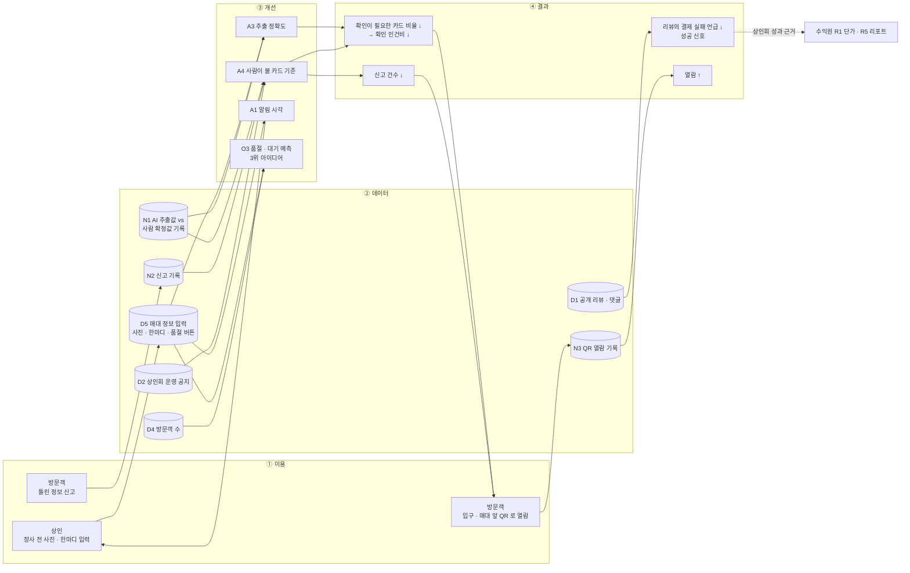

# BM 캔버스 — 야시장 오늘의 매대판 (수업 예시 · 가상 데이터)

- 대상: `ax/ideas_top3.md` 1위 · 기회 O1
- 재료: `ax/` 4개 파일(ideas_top3.md · jtbd.md · opportunity_matrix.csv · risk_check.md) · `painpoint/painpoint_def.md` · `valuechain/valuechain_v1.md` · `bm/survey_merchant_assoc.md`(상인회 설문 · 2026-11-11 추가) · `research/data/sources.md`(하단 AX 블록의 데이터 원천). 이 밖의 파일은 근거로 쓰지 않았다.
- 수익 모델 결정: `bm/revenue_options.md` 의 "결정" 절 참조
- 표기: 숫자 옆 (확인값 · 출처) = 재료에 출처가 있는 숫자 / (가정값) = 재료가 가정이라고 한 숫자 또는 근거 없는 숫자
- **팀 결정(2026-11-11)** = 사람이 정한 내용. 재료에 근거가 있으면 파일을, 없으면 `가정`을 단다.
- 칸마다 구성: **이 칸이 답할 질문** → **채운 내용** → **왜 이렇게 채웠나** → **비어 있는 곳** → 근거
- 이전 판: `bm/bm_canvas_v1.md` (레드팀 1차 검토 대상)

---

## 0. 왜 이 아이디어로 캔버스를 그리나

### 문제에서 출발한 흐름
1. **페인포인트** — VOC 300건(확인값 · painpoint_def.md)에서 구매자 문제 3개를 뽑았고, P1 "결제 수단 정보 없음"이 점수 60(확인값 · painpoint_def.md)으로 1위다. P2 운영 정보 불일치 36(확인값 · painpoint_def.md), P3 품절 · 대기 정보 없음 32(확인값 · painpoint_def.md)보다 크게 앞선다.
   - P1 점수 = 빈도 4(확인값 · painpoint_def.md) × 강도 3(확인값 · painpoint_def.md) × 해결 가능성 5(확인값 · painpoint_def.md). 강도 3(확인값 · painpoint_def.md)은 "포기 · 손해" 수준이다. 해결 가능성 5(확인값 · painpoint_def.md)는 세 문제 중 유일한 만점이다.
2. **밸류체인** — P1 은 4 주문 · 결제 단계의 병목이다. "매대별 결제 수단 목록 없음"은 정보만 있으면 줄어드는 포기라서, 밸류체인 맵에서 병목이면서 동시에 **기회**로 표시된 유일한 단계다.
3. **잡 스토리** — J1(기능적: 줄 서기 전에 결제 수단을 알고 싶다)과 J2(감정적: 현금 없이 와서 포기하고 돌아서지 않았으면)가 P1 에 붙는다.
4. **기회 매트릭스** — 기회 10개(확인값 · opportunity_matrix.csv) 중 O1 이 임팩트 4.5(확인값 · opportunity_matrix.csv)로 가장 높다. 실현성 4.0(확인값 · opportunity_matrix.csv)도 상위권이다.

### Top 3 중 1위로 고른 이유 (ideas_top3.md 순위 이유)
| 아이디어 | 임팩트 + 실현성 | 순위를 정한 이유 |
|---|---|---|
| 1위 매대판(O1) | 4.5(확인값) + 4.0(확인값) = 8.5(확인값 · ideas_top3.md) | 합이 가장 높다. P1 을 직접 줄인다. 11/16(확인값 · ideas_top3.md) MVP 로 화면 하나(매대 카드 목록)를 보여 줄 수 있다 |
| 2위 운영 정보 대조(O2) | 4.3(확인값) + 3.5(확인값) | 외부 데이터(지도 앱 약관)의 수집 권리를 아직 확인하지 않아 한 단계 내렸다 |
| 3위 대기 · 품절 예측(O3) | 4.0(확인값) + 3.5(확인값) | 1위가 쌓는 매대 입력 기록(D5)이 있어야 가능해서 1위 다음 순서 |

출처: ideas_top3.md · opportunity_matrix.csv

### 1위가 안고 있는 약점 (캔버스에서 계속 추적할 것)
- **책임 소재 미정** — AI 정리 정보가 틀렸을 때 누가 확인하고 고치는지 정하지 못한 채 Top 3 에 올렸다(risk_check.md). 리스크 4항목 중 유일한 "미정"이다.
- **돈** — 처음에는 팀 가정(ideas_top3.md)이었으나, 상인회 설문으로 매대 1곳당 월 5천 원(확인값 · survey_merchant_assoc.md) ~ 1만 원(확인값 · survey_merchant_assoc.md)을 낼 용의를 확인했다. 실제 계약 · 홍보 예산은 아직 확인 전이다(valuechain_v1.md · survey_merchant_assoc.md).
- **상인 쪽은 인터뷰 전** — 상인이 장사 중 휴대전화를 볼 틈이 없다는 것도 추정이다(jtbd.md).

---

## 1. 고객 세그먼트

**이 칸이 답할 질문** — 누구의 문제를 푸는가? 누가 쓰고, 누가 돈을 내는가?

**채운 내용** (팀 결정)
- **이용자 · 방문객** — 현금 없이 온 방문객.
- **지불자** — 야시장 상인회(가상).

**왜 이렇게 채웠나**
- 방문객을 "현금 없이 온 사람"으로 좁힌 것은 J2 "현금 없이 처음 방문했을 때(r_050) … 포기하고 돌아서지 않도록"에 맞춘 것이다. P1 진술문이 말하는 손해(줄을 다시 서거나 구매를 포기)를 가장 크게 겪는 층이다.
- 지불자를 상인회로 둔 이유: 방문객은 무료 정보에 익숙해 돈을 낼 이유가 약하다(valuechain_v1.md). ideas_top3.md 도 돈 낼 주체로 상인회를 적었다. 상인회는 매대 80곳(확인값 · valuechain_v1.md)을 묶는 유일한 주체다.

**비어 있는 곳**
- 상인회의 지불 용의는 설문으로 확인했다(survey_merchant_assoc.md). 실제 계약은 아직 없다. 상인 → 상인회 자릿세 흐름은 밸류체인에서 "가정 (상인 인터뷰 전)"이고 금액은 미확인이다.
- 정보를 입력하는 상인은 이 칸에 넣지 않았다(8 핵심 파트너 · 7 핵심 활동에서 다룸).

근거: jtbd.md · painpoint_def.md · valuechain_v1.md · ideas_top3.md · survey_merchant_assoc.md (자릿세 흐름은 가정)

## 2. 가치 제안

**이 칸이 답할 질문** — 고객의 무엇이 나아지는가?

**채운 내용** (팀 결정)
- 매대마다 **결제 수단 · 오늘 영업 여부 · 품절 메뉴**를 매대 카드 **한 화면**에 보여 준다.

**왜 이렇게 채웠나**
- 세 정보는 ideas_top3.md 1위의 "AI가 하는 일"(결제 수단 · 오늘 영업 여부 · 품절 메뉴를 뽑아 매대 정보 카드로 정리)과 같다.
- "한 화면"은 11/16(확인값 · ideas_top3.md) MVP 범위인 매대 카드 목록 화면 하나와 같다.
- 결제 수단이 첫 번째인 이유는 P1 점수 60(확인값 · painpoint_def.md)이 가장 크고 현금 없이 온 방문객(1칸)의 문제와 바로 닿기 때문이다.
- 각 정보가 P1 · P2 · P3 중 무엇을 직접 푸는지는 아래 **교차 확인 1** 참조.

**비어 있는 곳**
- 지불자(상인회)에게 주는 가치는 이번 칸에 적지 않았다. 상인회가 낼 용의는 설문으로 확인했지만(survey_merchant_assoc.md), 무엇 때문에 내는지는 설문 결과에 없어 미확인이다. 재료의 "리뷰의 결제 실패 언급 감소"(ideas_top3.md 성공 신호)와의 연결도 가정이다.

근거: ideas_top3.md · painpoint_def.md · jtbd.md

## 3. 채널

**이 칸이 답할 질문** — 방문객이 이 화면에 어떤 길로 닿는가?

**채운 내용** (팀 결정)
- **야시장 입구 QR 안내판**
- **매대 앞 QR 안내판**

**왜 이렇게 채웠나**
- ideas_top3.md 의 성공 신호가 "방문객이 **줄 서기 전에** 매대판을 열어 봄"이다. 입구 안내판은 둘러보기 시작 전에, 매대 앞 안내판은 줄 서기 직전에 화면을 열게 한다.
- 밸류체인에서 P1 은 4 주문 · 결제, P3 는 3 방문 · 둘러보기 단계 문제다. 두 단계 모두 방문객이 야시장 안에 있을 때라 현장 안내판과 시점이 맞는다.
- QR 안내판이라는 수단 자체는 재료에 없는 팀 결정이다.

**비어 있는 곳**
- QR 안내판 제작 · 설치를 누가 하고 비용이 얼마인지 미확인이다.
- 현장 채널은 야시장에 온 뒤에만 닿는다. 도착 전에 이 화면을 보는 경로는 이번 칸에 없다.

근거: ideas_top3.md · valuechain_v1.md · QR 안내판은 가정(팀 결정)

## 4. 고객 관계

**이 칸이 답할 질문** — 방문객이 이 정보를 믿고 계속 쓰게 하려면 어떤 관계가 필요한가?

**채운 내용** (팀 결정)
- **틀린 정보 신고 → 받아서 고쳐 주는 관계.** 방문객이 틀린 정보를 신고하면 그것을 받아 고친다.
- 카드마다 "AI 정리 · 상인 입력 hh:mm 기준"을 표시한다(ideas_top3.md).

**왜 이렇게 채웠나**
- risk_check.md 에서 O1 의 유일한 "미정"이 "AI가 정리한 정보가 틀렸을 때(예: '카드 가능'이라고 떴는데 현금만) 누가 확인하고 고치는지"다. 신고 → 수정 관계는 이 빈칸에 대응한다.
- 틀린 결제 수단 정보는 현금 없이 온 방문객에게 P1 실패를 그대로 다시 만든다. 그래서 신뢰 회복 장치를 관계의 중심에 둔다.

**비어 있는 곳**
- 신고를 **받아서 고치는 사람**이 누구인지 미정이다. 재료의 후보 두 안(결정은 사람):
  - 후보 A: 상인 본인이 확인
  - 후보 B: 상인회 사무국이 확인
- 신고 창구 형태(화면 버튼 등)는 미확인이다.

근거: risk_check.md · ideas_top3.md · painpoint_def.md · 신고 → 수정 관계는 가정(팀 결정)

## 5. 수익원

**이 칸이 답할 질문** — 누가, 무엇에, 얼마를 내는가?

**채운 내용** (결정: revenue_options.md R1 채택)
- **상인회 구독료(R1 · 구독형 단체 정액)** — 매대 1곳당 월 정액을 상인회가 낸다.
  - 시작 단가: 매대 1곳당 월 5천 원(확인값 · survey_merchant_assoc.md) — 설문 하한
  - 상한: 매대 1곳당 월 1만 원(확인값 · survey_merchant_assoc.md) — 설문 상한
  - 예상 월 매출: 5천 원 × 매대 80곳(확인값 · valuechain_v1.md) = 월 40만 원(가정값) ~ 1만 원 × 80곳(확인값 · valuechain_v1.md) = 월 80만 원(가정값)
- **방문객 과금** — 없음.
- **나중에 검토할 추가 수익(R5 · 보류)** — 상인회용 리뷰 · 매대 기록 정기 리포트. 매대 입력 기록이 쌓인 뒤 다시 본다.

**왜 이렇게 채웠나**
- 상인회 설문에서 매대 1곳당 월 5천 원(확인값 · survey_merchant_assoc.md) ~ 1만 원(확인값 · survey_merchant_assoc.md)을 낼 용의를 확인했다. 지불자 · 과금 단위(매대당 월)가 R1 과 정확히 맞아 R1 을 채택했다.
- 시작 단가를 하한 5천 원으로 둔 이유: 비용 금액이 모두 미확인이라 더 높은 단가를 정당화할 근거가 없고, 하한은 설문 범위 안에서 가장 받아들여지기 쉬운 값이다. 1만 원은 가치가 확인된 뒤 올릴 상한으로 둔다.
- 예상 월 매출이 가정값인 이유: 단가와 매대 수는 확인값이지만, 상인회가 매대 80곳(확인값 · valuechain_v1.md) 전부에 대해 실제로 계약한다는 것은 아직 확인되지 않았다(지불 용의 ≠ 계약).
- 방문객 과금이 없는 근거는 valuechain_v1.md 방문객 메모("돈을 낼 이유는 약함")다.

**비어 있는 곳**
- 실제 계약 · 홍보 예산 집행 여부는 미확인이다(survey_merchant_assoc.md).
- 설문의 응답 수 · 방법, 상인회가 낼 용의를 보인 이유는 미확인이다.
- 수익원이 상인회 하나뿐이다.

근거: survey_merchant_assoc.md · valuechain_v1.md · ideas_top3.md · revenue_options.md (월 매출은 가정 · 전 매대 계약 전)

## 6. 핵심 자원

**이 칸이 답할 질문** — 이 가치를 만들려면 무엇을 갖고 있어야 하는가?

**채운 내용** (팀 결정)
- **매대 정보 카드 자동 AI 처리** — 상인이 올린 사진 1장(확인값 · ideas_top3.md) · 한마디(음성 또는 글)에서 결제 수단 · 오늘 영업 여부 · 품절 메뉴를 뽑아 카드로 정리하는 기능.

**왜 이렇게 채웠나**
- 2칸의 세 정보를 한 화면에 모으는 일을 하는 것이 이 기능이다. opportunity_matrix.csv 에서 O1 의 역량이 "자동화"인 것과 맞는다.
- 이 기능이 쌓는 입력 기록(D5)은 3위 아이디어(O3 예측)의 재료가 된다(ideas_top3.md 순위 이유).

**비어 있는 곳**
- 어떤 모델 · 도구로 만들지 미확인이다.
- 입력 데이터(D5)는 서비스 운영 후에 생긴다(ideas_top3.md). 시작 시점에 카드를 무엇으로 채울지 미확인이다.

근거: ideas_top3.md · opportunity_matrix.csv · AI 구현 수단은 가정

## 7. 핵심 활동

**이 칸이 답할 질문** — 가치를 계속 만들려면 매일 무엇을 해야 하나? 사람과 AI 는 어떻게 나뉘나?

**채운 내용**
| # | 활동 | 누가 | 내용 |
|---|---|---|---|
| A1 | 상인 입력 안내 | 미정 | 상인에게 장사 시작 전 사진 · 한마디 올리는 법을 안내 |
| A2 | 상인 입력 | 상인 | 장사 시작 전 사진 · 한마디 업로드 |
| A3 | AI 정리 | AI | 결제 수단 · 오늘 영업 여부 · 품절 메뉴를 뽑아 매대 카드 생성 |
| A4 | 게시 전 확인 | 미정 | 카드가 맞는지 확인하고, 사진 속 손님 얼굴 · 계좌번호를 가림 |
| A5 | 신고 접수 · 수정 | 미정 | 방문객 신고를 받아 틀린 카드를 고침 |
| A6 | QR 안내판 설치 | 미정 | 입구 · 매대 앞에 QR 안내판을 둠 |

**왜 이렇게 채웠나**
- A2 · A3 의 사람 / AI 구분은 ideas_top3.md 의 "AI가 하는 일 / 사람이 하는 일"을 그대로 옮겼다.
- A1 은 상인이 장사 시간 저녁 6시~11시(확인값 · valuechain_v1.md)에 휴대전화를 볼 틈이 없다고 추정(jtbd.md)되어, 장사 전 입력을 따로 안내해야 하기 때문이다.
- A4 는 ideas_top3.md "게시 전에 누가 확인하는지는 미정"과 risk_check.md 개인정보 조건(게시 전 가림)을 합쳤다.
- A5 는 4칸 고객 관계(신고 → 수정), A6 는 3칸 채널(QR 안내판)을 돌리려면 필요한 활동이다.

**비어 있는 곳**
- A1 · A4 · A5 · A6 의 담당이 미정이다. A4 · A5 는 risk_check.md 의 책임 소재 후보 A(상인) · 후보 B(상인회 사무국)와 같은 문제다.

근거: ideas_top3.md · risk_check.md · jtbd.md · valuechain_v1.md

## 8. 핵심 파트너

**이 칸이 답할 질문** — 우리 혼자 할 수 없어서 누구의 협조가 꼭 필요한가?

**채운 내용** (팀 결정)
- **야시장 상인회(가상)**

**왜 이렇게 채웠나**
- 상인회는 지불자(1칸)이면서, 매대 80곳(확인값 · valuechain_v1.md)의 자릿세를 걷고 운영일을 정하는 주체다(valuechain_v1.md). 상인들에게 입력을 안내하고(A1) 운영 공지(D2)를 갖고 있는 쪽이라 협조 없이는 서비스가 돌지 않는다.
- 오류 확인 책임 후보 B 의 주체이기도 하다(risk_check.md).

**비어 있는 곳**
- 상인회의 지불 용의는 설문으로 확인했다(survey_merchant_assoc.md). 실제 계약 · 홍보 예산은 미확인이다(valuechain_v1.md).
- 매일 입력하는 상인은 파트너 칸에 적지 않았다. 상인 인터뷰는 아직 하지 않았다(jtbd.md).

근거: valuechain_v1.md · ideas_top3.md · risk_check.md · jtbd.md

## 9. 비용 구조

**이 칸이 답할 질문** — 핵심 활동을 돌리는 데 무엇에 돈이 드는가?

**채운 내용** (팀 결정)
| 비용 항목 | 금액 |
|---|---|
| 상인 입력 안내 | 미확인 |
| 게시 전 확인하는 사람의 인건비 | 미확인 |

**왜 이렇게 채웠나**
- 서비스는 상인 입력이 있어야 시작되고(ideas_top3.md 사람이 하는 일), 게시 전 확인은 risk_check.md 의 책임 소재 미정을 메우는 활동이다. 두 비용 모두 사람이 하는 일이라 이 서비스의 반복 비용이다.
- 확인 인건비는 매대 80곳(확인값 · valuechain_v1.md)의 카드를 영업일마다 확인할 수 있어 규모가 커질 수 있다.
- 각 비용이 어느 핵심 활동에서 생기는지는 아래 **교차 확인 2** 참조.

**비어 있는 곳**
- 두 비용 모두 금액이 재료에 없어 미확인이다. 그래서 월 40만 원(가정값) ~ 80만 원(가정값) 매출로 손익이 맞는지 아직 판단할 수 없다.
- 게시 전 확인을 누가 하는지 미정이라, 인건비를 누가 지는지도 미정이다.

근거: ideas_top3.md · risk_check.md · valuechain_v1.md · 금액은 가정

---

## 교차 확인

### 교차 확인 1 — 가치 제안은 P1 · P2 · P3 중 무엇을 직접 푸나

| 가치 제안의 정보 | 직접 푸는 페인포인트 | 맞물리는 근거 | 덜 맞는 부분 |
|---|---|---|---|
| 결제 수단 | **P1** 결제 수단 정보 없음 — 점수 60(확인값 · painpoint_def.md) | P1 진술문 "매대마다 결제 수단(현금 · 카드 · 이체 · 페이)이 다른데 미리 알 수 없어". J1 · J2. 1칸 "현금 없이 온 방문객"과 같은 사람 | 없음. 채널(매대 앞 QR)도 P1 단계(4 주문 · 결제)와 시점이 맞음 |
| 오늘 영업 여부 | **P2** 운영일 · 운영시간 정보 불일치 — 점수 36(확인값 · painpoint_def.md) | J3 "가려는 매대가 여는지 확인". ideas_top3.md 1위의 "+J3" | P2 의 여정 단계는 **알아보기 · 이동**(도착 전 헛걸음)인데, 채널이 현장 QR 이라 도착 전에는 보지 못함. 현장에서는 매대별 영업 여부만 풀림 |
| 품절 메뉴 | **P3** 인기 메뉴 품절 · 대기 정보 없음 — 점수 32(확인값 · painpoint_def.md) | P3 진술문 "품절 시점을 알 수 없어". J6 | P3 의 **대기 시간**은 가치 제안에 없음. J6 은 "도착 전에" 알고 싶다인데 채널이 현장 QR. 품절은 장사 중에 생기는데 상인 입력은 장사 시작 전(ideas_top3.md) |

출처: painpoint_def.md · jtbd.md · ideas_top3.md · valuechain_v1.md

### 교차 확인 2 — 비용 구조의 각 비용은 핵심 활동의 어느 일에서 생기나

| 비용 항목 | 생기는 핵심 활동 | 설명 |
|---|---|---|
| 상인 입력 안내 | A1 상인 입력 안내 (→ A2 상인 입력을 가능하게 함) | 상인이 장사 전 사진 · 한마디를 올리도록 안내하는 일 |
| 게시 전 확인하는 사람의 인건비 | A4 게시 전 확인 (카드 확인 · 개인정보 가림) | 담당이 미정이라 인건비를 누가 지는지도 미정 |

**비용 항목이 연결되지 않은 핵심 활동**

| 핵심 활동 | 비용 구조에 대응 항목 | 상태 |
|---|---|---|
| A2 상인 입력 | — | 상인이 직접 함 |
| A3 AI 정리 | 없음 | 미확인 |
| A5 신고 접수 · 수정 | 없음 | 미확인 (A4 와 같은 사람이 하는지 미정) |
| A6 QR 안내판 설치 | 없음 | 미확인 |

출처: 이 캔버스 7칸 · 9칸 · risk_check.md · ideas_top3.md

---

## AX 블록 — 학습 루프와 데이터 원천의 흐름

**이 블록이 답할 질문** — 서비스를 쓸수록 어떤 데이터가 쌓이고, 그 데이터가 어느 활동을 고쳐서 어떤 결과로 돌아오는가?

### 흐름도

### 데이터 원천표

| id | 데이터 | 생기는 곳(①) | 흘러가는 곳(③ 개선 / ④ 결과) | 지금 상태 | 근거 |
|---|---|---|---|---|---|
| D5 | 매대 정보 입력(사진 · 한마디 · 품절 버튼) | A2 상인 입력 | A3 AI 정리의 입력 · A1 알림 시각 조정 · O3 예측 재료 | 서비스 시작 뒤 생김. 상인 동의 필요 | sources.md · ideas_top3.md |
| N1 | AI 추출값과 사람 확정값의 차이 | A4 게시 전 확인 | A3 추출 정확도 개선(정답 데이터) · A4 확인 대상 기준 조정 | 재료에 없음, 새로 설계해야 함 | 가정 |
| N2 | 신고 기록(유형 · 매대 · 시각) | 4칸 고객 관계 · A5 | A4 확인 기준 조정 · ④ 신고 건수 | 재료에 없음, 새로 설계해야 함 | 가정 |
| N3 | QR 열람 기록 | 3칸 채널(QR 안내판) | ④ 열람 수 = 성공 신호 "줄 서기 전에 매대판을 열어 봄" | 재료에 없음, 새로 설계해야 함 | ideas_top3.md(성공 신호) · 기록 방식은 가정 |
| D2 | 상인회 운영 공지(운영일 · 시간 · 휴장) | 상인회 사무국 | A4 에서 상인 입력의 "오늘 영업 여부"와 대조 | 미보유 · 상인회와 협의 전 · 월 1회(확인값 · sources.md) 갱신 | sources.md |
| D1 | 공개 리뷰 · 댓글 300건(확인값 · sources.md) | 리뷰 채널(5 사후) | ④ 결제 실패 언급의 **기준치** | 보유. 단 수업 안에서만 사용 · 갱신 없음 → 서비스 후 리뷰 수집 원천은 미확인 | sources.md · painpoint_def.md |
| D4 | 야시장 일별 방문객 수 | 대구시 공공데이터(가상 설정) | O3 품절 · 대기 예측(3위, 보류) | 미보유 · 공공누리 제1유형이라고 가정 · 월 1회(확인값 · sources.md) | sources.md |

### 루프가 도는 순서
1. **첫 바퀴(콜드 스타트)** — D5 · N1 · N2 · N3 는 아직 없다. 쓸 수 있는 것은 D1 뿐이다(sources.md). 그래서 처음에는 사람이 거의 모든 카드를 확인하고(A4), D1 으로 결과의 기준치만 잡는다.
2. **바퀴가 돌수록** — N1 이 쌓여 A3 정확도가 오르고, A4 에서 사람이 볼 카드가 줄어든다. 비용 구조의 "게시 전 확인 인건비"가 줄어드는 길이다.
3. **D5 가 충분히 쌓이면** — D4 와 함께 3위 아이디어(O3 예측)를 열 수 있다(ideas_top3.md 순위 이유).
4. **결과가 쌓이면** — 상인회에 보여 줄 성과가 생긴다. 단가를 상한 1만 원(확인값 · survey_merchant_assoc.md)으로 올리는 논의와 R5 리포트의 근거가 된다(revenue_options.md).

### 비어 있는 곳
- N1 · N2 · N3 는 재료에 없는 새 데이터다. 저장 방식 · 보관 기간은 미확인이다.
- 학습에 쓰려면 상인 동의 범위에 "학습 이용"이 들어가야 한다. 동의는 가입 때 이용 약관으로 받을 예정이다(sources.md). 학습 이용이 들어가는지는 미확인이다.
- 사진은 손님 얼굴 · 계좌번호를 가린 뒤의 것만 학습에 쓴다(risk_check.md · sources.md).
- 서비스 시작 뒤 리뷰를 모을 원천은 미확인이다. D1 은 갱신이 없다.

근거: sources.md · ideas_top3.md · risk_check.md · painpoint_def.md · survey_merchant_assoc.md · revenue_options.md (N1 · N2 · N3 는 가정)
