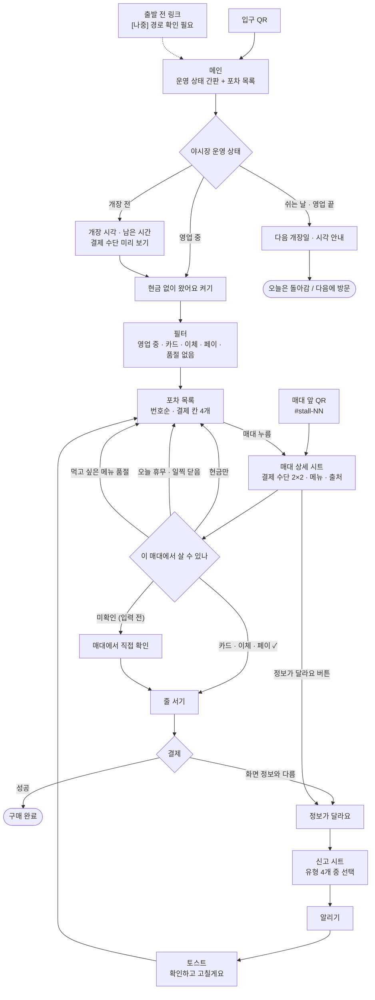

# 유저 플로우 — 야시장 오늘의 매대판

> 작성 2026-11-12 · 근거: `spec/시나리오.md`(장면 1~5 · US-01~05) · `index.html`(현재 화면) · `spec/decision_log.md`
> 주인공: 금요일 저녁, 현금 없이 서문시장 야시장에 처음 가는 대구 직장인 A
> 표기: **[필수]** / **[나중]** = 시나리오 스토리 구분 · **확인 필요** = 재료에 없음

---

## 1. 들어오는 길

| 진입점 | 언제 | 처음 보는 화면 | 스토리 | 상태 |
|---|---|---|---|---|
| 입구 QR 안내판 | 야시장 입구 도착 | 메인 (운영 상태 + 포차 목록) | US-02 [필수] | 화면 있음 · QR 설치 주체 **확인 필요** |
| 매대 앞 QR | 줄 서기 직전 | 메인 → 해당 매대 상세가 바로 열림 (`#stall-05`) | US-04 [필수] | 화면 있음 |
| 출발 전 링크 | 퇴근 전 | 메인 (운영 상태 간판) | US-01 [나중] | 도착 전 경로 **확인 필요** (BM 채널은 현장 QR뿐) |

---

## 2. 전체 흐름

---

## 3. 화면 목록

| id | 화면 | 보이는 것 | 사용자가 하는 일 | 다음 화면 | 스토리 |
|---|---|---|---|---|---|
| S1 | **메인** | 줄조명 · 네온 제목 · 운영 상태 간판(영업중 · 곧 열어요 · 쉬는 날 · 영업 끝) · 진행 막대 · 출처 줄 · 칠판 스위치 · 필터 칩 · 천막 아래 포차 목록 | 운영 여부 확인 · 현금 없이 켜기 · 필터 · 매대 누르기 · 오늘 / 영업일 시연 전환 | S2 | US-01 · US-02 |
| S2 | **매대 상세 시트** | 홍등 번호 · 이름 · 상태 · 결제 수단 2×2(가능 ✓ / 불가 취소선 / 미확인 ?) · 메뉴(품절 꼬리표) · "AI 정리 · 상인 입력 hh:mm · N분 전" | 결제 수단 확인 · 확인 닫기 · 정보가 달라요 | S1 · S3 | US-04 |
| S3 | **신고 시트** | "어떤 정보가 실제와 달랐나요?" · 결제 수단 / 영업 여부 / 품절 / 다른 문제 | 하나 고르기 → 알리기 (고르기 전에는 꺼져 있음) | S4 | US-05 |
| S4 | **토스트** | "알려 주셔서 고마워요. 확인하고 고칠게요" | — (2.4초 뒤 사라짐) | S1 | US-05 |

---

## 4. 갈림길 — 시스템이 보여 주는 것

| # | 조건 | 시스템은 | 사용자의 다음 행동 | 근거 |
|---|---|---|---|---|
| B1 | 야시장 영업 중 | 민트 "영업중" 간판 · "지금 N곳이 불을 켰어요" · 마감까지 남은 시간 | 목록 보기 | US-01 인수 1 · 2 |
| B2 | 개장 전 | 전구색 "곧 열어요" · 개장 시각 · 남은 시간. 목록은 지난 영업일 입력 기준 | 결제 수단 미리 보기 | US-01 인수 4 |
| B3 | 쉬는 날 · 영업 끝 | 핑크 간판 · 다음 개장일 · 시각. 매대는 모두 "쉬는 날" | 돌아감 | US-01 예외 "오늘 안 나옴" |
| B4 | 현금 없이 왔어요 켬 | 카드 · 이체 · 페이 중 하나라도 되는 매대만, 현금 칸 흐리게 | 남은 매대 고르기 | US-02 인수 2 |
| B5 | 매대 입력 전 | "입력 전 · 휴무인지 아직 몰라요", 결제 칸 4개 모두 점선 ? | 매대에서 직접 확인 | US-02 · US-04 예외 "정보 없음" |
| B6 | 매대 오늘 휴무 · 일찍 닫음 | 불 꺼진 홍등 · 회색 천막 · 핑크 상태 글자 | 다른 매대 | US-02 예외 "오늘 안 나옴" |
| B7 | 메뉴 품절 | 목록 "OO 품절"(핑크) · 상세 메뉴 취소선 + 품절 꼬리표 | 다른 메뉴 · 다른 매대 | US-03 인수 2 · US-04 예외 "품절" |
| B8 | 마지막 입력이 90분 넘음 | "N시간 전 정보" 꼬리표 | 정보 참고만 · 매대에서 확인 | US-03 예외 "정보 오래됨" · 기준 시간 **확인 필요**(D-11) |
| B9 | 정보가 실제와 다름 | 신고 시트 → 기록 → "확인하고 고칠게요" | 목록으로 돌아감 | US-05 · 처리자 **미정**(D-04) |

---

## 5. 직장인 A의 금요일 저녁 경로

### 5-1. 잘 풀린 경로

| 순서 | 장면 | A가 하는 일 | 화면 | 걸리는 시간 |
|---|---|---|---|---|
| 1 | 서문시장역 도착 · 입구 | 입구 QR 찍기 | S1 · 간판 "영업중" | **확인 필요** |
| 2 | 입구 | "현금 없이 왔어요" 켜기 | S1 · 살 수 있는 포차만 남음 | |
| 3 | 둘러보기 | 05 막창구이 누르기 | S2 · 카드 ✓ · 대창 품절 | |
| 4 | 매대 앞 | 카드 되는 것 확인 → 막창으로 줄 서기 | — | |
| 5 | 결제 | 카드로 결제 | 구매 완료 | |

### 5-2. 막히는 경로 (예외)

| 순서 | 상황 | A가 하는 일 | 화면 | 갈림길 |
|---|---|---|---|---|
| 1 | 매대 앞 QR 찍음 → 06 호떡 | 상세 열림, 결제 칸 모두 "?" | S2 | B5 정보 없음 |
| 2 | | 상인에게 직접 물어봄 → 현금만 | — | |
| 3 | 화면 정보와 다를 수 있음 | "정보가 달라요" → "결제 수단이 달라요" → 알리기 | S3 → S4 | B9 |
| 4 | | 목록으로 돌아가 다른 포차 고르기 | S1 | B4 |

---

## 6. 아직 흐름에 없는 것

| # | 빠진 흐름 | 이유 | 스토리 |
|---|---|---|---|
| G1 | 도착 전(퇴근 전)에 매대판으로 들어오는 길 | 현장 QR 말고 경로가 없음 — **확인 필요** | US-01 [나중] |
| G2 | 대기 시간 보고 줄 고르기 | 대기 추정은 3위 아이디어라 화면에서 뺌 (D-03) | US-03 [나중] |
| G3 | 신고 뒤 고쳐졌는지 알려 주기 | 처리자 미정 (D-04) · 회신 방식 재료에 없음 | US-05 |
| G4 | 이미 결제를 못 한 방문객에게 해 줄 것 | 재료에 없음 (레드팀 CUS-02) — **확인 필요** | US-05 |
| G5 | 외국어 화면 | 다국어는 별도 기회 O4 · MVP 포함 미정 | — |
